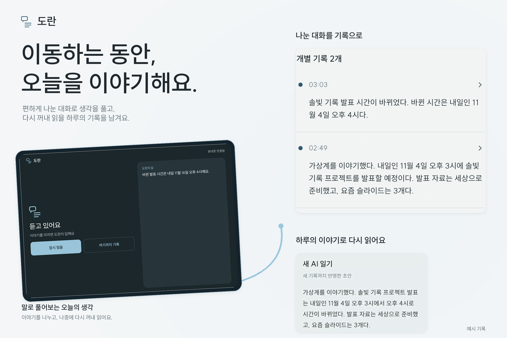

# 도란

차에서 나눈 이야기를 하루의 기록으로 남깁니다.

이동 중 누군가에게 이야기하고 싶거나, 머릿속 생각을 말로 정리하고 싶은 순간을 위해 만들었습니다. 따로 시간을 내어 글을 쓰는 부담을 줄이고, 평범한 하루도 나중에 다시 돌아볼 수 있도록 돕습니다.

[도란 소개 영상 보기](https://github.com/Mango-Juice/doran/releases/download/v1.0.0-round1/doran-intro.mp4)

[시연 영상 보기](https://github.com/Mango-Juice/doran/releases/download/v1.0.0-round1/doran-demo.mp4)

차량에서 나눈 대화는 개별 기록으로 남고, 같은 날의 기록은 하나의 하루 일기로 모입니다. 휴대폰에서 읽고 직접 다듬을 수 있으며, 이후 기록이 추가돼도 직접 쓴 글은 유지됩니다. 새 AI 초안과 비교해 반영하거나 기록별 개인화 사용을 끄고 삭제할 수 있습니다.

## 설치

| 앱 | 다운로드 | 실행 환경 |
|---|---|---|
| 차량 | [남생이_도란_release.apk](apk/남생이_도란_release.apk) | Pleos Connect 2.1.0, Android 14 ARM64 |
| 모바일 | [남생이_도란모바일_release.apk](apk/남생이_도란모바일_release.apk) | Android |

두 APK는 서로 다른 기기에 설치합니다. 네트워크와 도란 서버 연결이 필요합니다. 파일 해시와 빌드 기준은 [제출 파일 목록](release-manifest.json)에서 확인할 수 있습니다.

1. 차량 APK를 Pleos 에뮬레이터에, 모바일 APK를 Android 기기에 설치합니다.
2. 모바일에서 Google 계정으로 로그인하고 데이터 처리 동의를 확인합니다.
3. 주차 상태의 차량에 표시된 연결 코드를 모바일에 입력한 뒤 차량에서도 연결을 확인합니다.
4. 필요하면 모바일 설정에서 차량 정보 활용과 목적지 이름 제공에 각각 동의합니다. 목적지 이름은 동의한 경우에만 서버와 AI에 전달됩니다.
5. 차량에서 ‘대화 시작’을 누르면 도란이 먼저 질문합니다. ‘여기까지 기록’을 누르면 모바일에서 기록과 하루 일기를 확인할 수 있습니다.

## 차량에서 쓰는 기능

Pleos SpeechToText와 TextToSpeech로 듣고 답합니다. 주행 중에는 긴 대화문과 설정을 숨기고 일시정지와 종료 조작을 유지합니다. 목적지 이름과 관련된 지난 이야기를 참고해 첫 질문을 건네며, 목적지 정보와 남은 시간은 동의, 권한과 유효성을 확인한 경우에만 사용합니다.

현재 검증한 SDK·에뮬레이터 조합에서는 자동 좌석 판단을 사용하지 않습니다. 동승 상태가 불명확하면 사적인 과거 이야기를 먼저 꺼내지 않습니다. [SDK 지원 범위](docs/car-sdk.md)

## 시연과 검증

시연 영상은 출근길과 저녁 약속을 대화로 남기고, 모바일에서 일기를 다듬는 흐름을 보여줍니다. 귀가길 대화가 추가된 뒤에도 직접 쓴 일기는 유지됩니다. 영상의 기록과 차량 상태는 시연용 예시입니다.

차량 화면은 Pleos Connect 2.1.0의 1920×1080 및 분할 화면을 기준으로 확인했습니다. 모바일은 Android 에뮬레이터와 iOS 시뮬레이터에서 검증했으며, iOS 설치 파일은 제출물에 포함하지 않습니다. 실차 주행과 장시간 음성 품질은 별도 검증 대상입니다. [검증 범위](docs/verification.md)

## 개발

| 경로 | 구성 |
|---|---|
| `apps/car` | Kotlin, Jetpack Compose |
| `apps/mobile` | Flutter, Riverpod |
| `supabase` | Edge Functions, PostgreSQL, Auth, Realtime, Queues |
| `contracts` | 앱과 서버의 API 계약 |

JDK 21, Flutter 3.50.0, Deno 2.5.6을 사용합니다. 도구 버전은 [toolchain.json](toolchain.json)에 고정되어 있습니다. 빌드와 서버 설정은 [개발 안내](docs/setup.md), 요청·응답 형식은 [API 계약](contracts/api.md)을 참고하세요.

차량 음성 원본은 도란 서버나 외부 AI에 전송하지 않습니다. 대화 텍스트와 허용된 맥락으로 응답·기록을 생성합니다. [개인정보 처리 안내](docs/privacy.md)

남생이 팀의 현대자동차그룹 차량용 앱 개발 공모전 출품작입니다. 자체 코드에 별도 오픈소스 이용허락을 부여하지 않으며, 제3자 소프트웨어와 자산의 조건은 [라이선스 안내](docs/dependencies.md)를 따릅니다.
